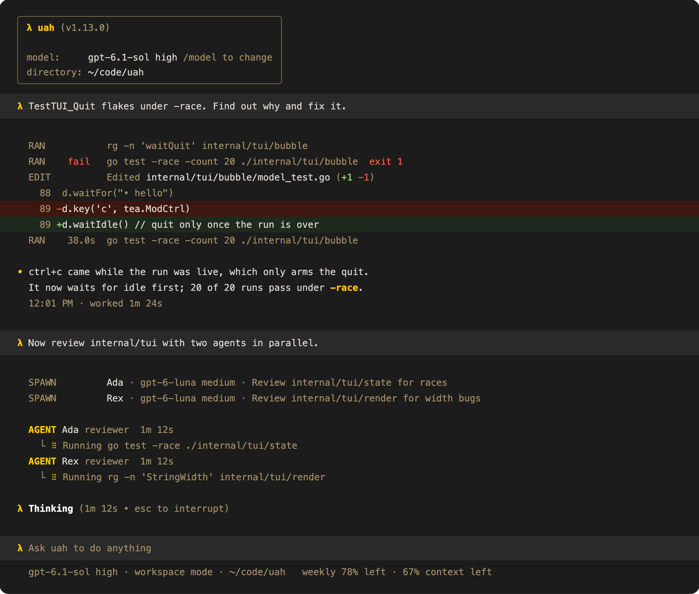

<!-- memoria:section id="overview" files="cmd/uah/main.go go.mod .github/workflows/memoria.yml .github/memoria-workflows/memoria.yml.json" -->
# uah

<p align="center">
  <a href="https://github.com/viktordanov/uah/actions/workflows/ci.yml"></a>
  <a href="https://github.com/viktordanov/uah/actions/workflows/memoria.yml"></a>
  <a href="https://github.com/viktordanov/uah/releases/latest"></a>
  <a href="https://aur.archlinux.org/packages/uah-bin"></a>
  <a href="LICENSE"></a>
</p>

<p align="center"></p>

uah is a fully featured coding agent harness for the terminal, written in Go. It runs the agent loop in process on [uah-core](https://github.com/viktordanov/uah-core), executes the model's tool calls in the operating system's sandbox behind command rules and approvals, and keeps sessions on disk to resume, search, and rewind. It runs on a ChatGPT subscription through the Codex login, or on an API key ([providers and sign-in](#providers-and-sign-in)).

```sh
brew install viktordanov/tap/uah
codex login    # once, for the ChatGPT subscription
uah            # in a repository
```

uah runs on macOS and Linux, on arm64 and x86_64; there is no Windows build. It has a TUI, and `uah exec` and `uah review` for scripts and CI.

Contents:

1. [Features](#features)
2. [Where to start](#where-to-start)
3. [Get started](#get-started), with the [keys](#keys)
4. [Providers and sign-in](#providers-and-sign-in)
5. [Coming from Codex or Claude Code](#coming-from-codex-or-claude-code)
6. [Context preparation](#context-preparation)
7. [Configuration](#configuration)
8. [Development](#development), with the [code map](#code-map)
9. [License and acknowledgements](#license-and-acknowledgements)

## Features

- **[Context preparation](#context-preparation):** every new session starts with one developer message of facts about its shell, sandbox, git state, and loaded instruction files, built from Markdown modules you can extend.
- **[Sessions](docs/guide.md#resume-a-session):** kept on disk with a SQLite index; resume them (`uah resume`), search them (`uah sessions --search`), [rewind](docs/guide.md#go-back-to-an-earlier-message) one to an earlier message, and recall earlier prompts per folder with ↑ and ctrl+r.
- **[Subagents](docs/guide.md#subagents-and-agent-files):** Codex's multi-agent tools (`spawn_agent`, `send_input`, `wait_agent`), run in parallel in the background, with roles from Markdown or TOML agent files, per-subagent model and effort, and `fork_context`.
- **[Goals](docs/guide.md#goals):** `/goal <objective>` continues the agent until it marks the goal complete with `update_goal`, up to 16 goal turns in one run, within a token budget, a cap on continuations, and no-progress guards.
- **[Instructions and skills](docs/guide.md#agentsmd-and-skills):** AGENTS.md from the project root down, with `@path` imports; skills from `.agents/skills`, `~/.uah/skills`, and `$CODEX_HOME/skills`, loaded by the model or by naming one as `$name`.
- **Tools:** Bash, `apply_patch` with diffs in the transcript, `view_image`, [questions with options](docs/guide.md#answer-the-agents-questions) (`request_user_input`), the provider's hosted [web search](docs/guide.md#web-search), and [MCP servers](docs/guide.md#mcp-setup) over stdio and streamable HTTP with OAuth, resources, and prompts.
- **[Sandbox and approvals](docs/guide.md#permission-modes):** Seatbelt on macOS and bubblewrap on Linux; read-only, workspace, auto, and yolo modes on shift+tab; [command rules](docs/guide.md#command-rules) as Starlark `prefix_rule` entries; an auto-reviewer that decides escalations in auto mode.
- **[Compaction](docs/guide.md#compaction-and-clear):** the provider's own on OpenAI providers, else a summary with a state ledger of changed files, failing commands, and loaded skills, after old tool outputs are elided first; `/context` shows what fills the window.
- **[Hooks](docs/guide.md#hook-setup):** Claude Code's contract (JSON on stdin, exit 2 blocks) for ten events, from `SessionStart` to `PermissionRequest`; project hooks run only after `uah hooks trust`.
- **[Headless](docs/guide.md#headless-mode):** `uah exec` with JSONL events, `-o` for the final answer, `--ephemeral`, and a tool policy (`--tools`, `--deny-tools`); [`uah review`](docs/guide.md#review-your-changes) runs `/review`'s read-only reviewer.
- **[Usage](docs/guide.md#usage-limits):** the ChatGPT plan's rate limits in the footer and `uah usage`, and how much of each session's input the prompt cache served.

> [!NOTE]
> The docs are kept in sync with the code by [Memoria](https://github.com/viktordanov/rs-memoria): CI fails when code changes and its README hasn't been reviewed.
<!-- /memoria:section -->

---

<!-- memoria:section id="usage" files="cmd/uah/main.go cmd/uah/models.go cmd/uah/run.go cmd/uah/review.go cmd/uah/reviewtext.go cmd/uah/resume.go cmd/uah/sessions.go cmd/uah/sessionsrm.go internal/app/sessionid.go cmd/uah/tui.go cmd/uah/tuiconfig.go cmd/uah/print.go cmd/uah/completion.go cmd/uah/doctor.go internal/app/doctor.go internal/app/doctorchecks.go cmd/uah/flags.go cmd/uah/prompts.go internal/images/images.go internal/images/store.go internal/images/paths.go internal/images/clipboard/clipboard.go internal/images/clipboard/macos.go internal/images/clipboard/linux.go internal/images/clipboard/write.go internal/app/usershell.go internal/usershell/usershell.go internal/usershell/record.go internal/usershell/capture.go cmd/uah/usage.go internal/app/planusage.go cmd/uah/exit.go cmd/uah/exit_internal_test.go internal/codereview/codereview.go internal/codereview/output.go internal/codereview/display.go internal/gitdiff/diff.go internal/gitdiff/refs.go internal/history/history.go internal/history/recorder.go" -->
## Where to start

- **Trying uah for the first time:** [Get started](#get-started), then the [keys](#keys).
- **Choosing a provider, or signing in:** [providers and sign-in](#providers-and-sign-in).
- **Moving from Codex or Claude Code:** [what carries over](#coming-from-codex-or-claude-code).
- **Doing one task**, such as resuming a session, setting a goal, or reviewing your changes: the [task guides](docs/guide.md).
- **Running it from a script or CI:** [headless mode](docs/guide.md#headless-mode).
- **Teaching the agent about your project:** [context preparation](#context-preparation), and [AGENTS.md and skills](docs/guide.md#agentsmd-and-skills).
- **Changing a setting:** [configuration](#configuration), and the [reference](docs/configuration.md) for every key.
- **Changing uah itself:** [development](#development) and the [code map](#code-map).

---

## Get started

1. Install it:

   ```sh
   brew install viktordanov/tap/uah                                 # macOS and Linux
   yay -S uah-bin                                                   # Arch Linux (AUR)
   go install github.com/viktordanov/uah/cmd/uah@latest  # from source, Go 1.27.1 or later
   ```

   Or grab an archive from the [releases](https://github.com/viktordanov/uah/releases).

2. Sign in with `codex login`; uah uses your ChatGPT account and refreshes the login as Codex does. For an API key instead, see [providers and sign-in](#providers-and-sign-in).
3. Run `uah doctor`. It checks the login, sandbox, config, and MCP servers, and says how to fix anything that fails. The TUI logs to `~/.uah/logs/uah-tui.log`.
4. Start in a repository:

   ```sh
   cd ~/code/proj
   uah                                       # the TUI
   uah "Fix the failing test in pkg/foo"     # the TUI, starting with a prompt
   ```

   The TUI draws only what changed on the screen. Left open, it uses no CPU; while the agent streams an answer it uses about half the CPU of 1.8.4, and scrolling and typing a third and a quarter ([TUI design](docs/design/tui.md#framework-revised-our-own-terminal-layer)).

5. If you installed with `go install`, add shell completion (bash, zsh, fish, or pwsh):

   ```sh
   uah completion zsh > "${fpath[1]}/_uah"
   ```

### Keys

| Key | Does |
| --- | --- |
| enter | Send. While the agent works, it reads the message after its running tool calls, before its next model request. On an empty prompt, it sends the queued messages now, in order |
| ctrl+enter | While the agent works, send now: the model's response under way is dropped and asked for again with the message; running tool calls go on. Only where the terminal tells ctrl+enter from enter (kitty, Ghostty; in tmux, `set -s extended-keys on`); elsewhere it arrives as enter. While idle, as enter |
| tab | While the agent works, queue the message: it goes out when the run ends. While idle, send |
| ctrl+j, alt+enter, shift+enter | New line; ctrl+j and alt+enter work in every terminal, alt+enter on macOS where Option sends Meta. In tmux without extended keys, shift+enter arrives as enter and sends; see the [keys design](docs/design/keys.md) |
| esc esc | Interrupt; queued messages stay. While the agent is idle, on an empty prompt: go back to an earlier message and edit it |
| ↑ / ↓ on an empty prompt | Your earlier prompts in this folder, from this session and earlier ones; ↓ past the newest empties the prompt again. With messages queued, ↑ takes the last one back first |
| ctrl+r | Search your earlier prompts; see [Reuse an earlier prompt](docs/guide.md#reuse-an-earlier-prompt) |
| `/` | Commands, such as `/model`, `/effort`, `/goal`, `/compact`, `/context`, `/diff`, `/review`, `/mcp`, `/agents`, `/status`, `/resume`, and `/new` |
| `@` | Mention a workspace file (fuzzy search) |
| `$` | Complete a skill's name; a sent `$name` loads the skill for the turn. `[tui] skill_mentions = false` turns both off |
| ↑ / ↓, 1–9, n, enter, tab | When the agent asks questions: choose an option, pick one by its number, add a note, answer, and go to the next question; the last row takes your own words. See [Answer the agent's questions](docs/guide.md#answer-the-agents-questions) |
| ctrl+t | The detailed view: turns, tokens, and each tool's result |
| ctrl+g | Edit the prompt in `$VISUAL` or `$EDITOR` (vim by default); the saved text comes back as the prompt, with its images. The draft file lives in `~/.uah/editor`, where sandboxed commands cannot reach it |
| a click on a file path | Peek at the file in an overlay over the session (esc closes it, `e` opens it in the editor, `o` with the system), or open it in `$VISUAL` / `$EDITOR` at its line or with the system's default app, as `[tui] file_links` says |
| drag, double click, triple click | Select transcript text, a word, or a line, and copy it to the clipboard. `[tui] mouse = false` leaves selection to the terminal |
| wheel, pgup / pgdn, end | Scroll the transcript; end returns to the bottom. Scrolled up, the screen stays on what you read while output arrives, and `New activity · ↓ Back to bottom · end` shows over its last row (a click on it returns too) |

The [TUI README](internal/tui/README.md) lists every key and command, and the [task guides](docs/guide.md) show them at work.

---

## Providers and sign-in

`provider` in the configuration, or `--provider`, picks the backend; `openai-codex` is the default.

| Provider | Sign-in | What only it has |
| --- | --- | --- |
| `openai-codex` | The ChatGPT subscription: `codex login` once; uah reads Codex's login and refreshes it as Codex does | The plan's usage in the footer and `uah usage` |
| `openai` | `OPENAI_API_KEY` | |
| `openrouter` | `OPENROUTER_API_KEY` | Every model OpenRouter serves, Claude's included |
| `fireworks` | `FIREWORKS_API_KEY` | |
| `ollama` | None: a local server at `http://localhost:11434/v1` | |

The two OpenAI providers also have priority processing (`/fast`), the hosted web search, and the provider's own compaction. Other providers compact with uah's summary, and have no web search.

uah has no Anthropic provider: Claude models work only with an API key, through OpenRouter. Signing in with a Claude subscription is not planned, because of Anthropic's policy on third-party tools; a provider for Anthropic's API, with an API key, may come later.

---

## Coming from Codex or Claude Code

uah reads what you already have, so a setup from Codex or Claude Code mostly carries over:

| You have | In uah |
| --- | --- |
| A Codex login (`codex login`) | uah uses the same ChatGPT login and refreshes it as Codex does; your plan's usage shows in the footer |
| `AGENTS.md` and `AGENTS.override.md` | Found the same way, from the project root down; `project_doc_fallback_filenames = ["CLAUDE.md"]` reads `CLAUDE.md` too |
| Skills in `.agents/skills` or `$CODEX_HOME/skills` | Offered as they are, beside `~/.uah/skills` |
| `[mcp_servers]` in Codex's `config.toml` | The same format; `uah mcp add` writes it |
| Codex's `.rules` files with `prefix_rule` | The same [command rules](internal/rules/README.md) |
| Claude Code's `.claude/agents/*.md` | Work as [agent files](docs/guide.md#subagents-and-agent-files), as do Codex's TOML role files |
| Claude Code hooks | The same contract: JSON on stdin, exit 2 blocks ([hooks](internal/hooks/README.md)) |
| `--dangerously-bypass-approvals-and-sandbox` | Accepted, as uah's `--yolo` |

uah keeps everything of its own in `~/.uah`, not `~/.codex`; the [configuration](#configuration) section has the files and their order.
<!-- /memoria:section -->

---

<!-- memoria:section id="context" files="cmd/uah/context.go cmd/uah/prompts.go" -->
## Context preparation

Every new session, a subagent's included, starts with one message of facts the model would otherwise learn by failing: which shell runs its commands and which constructs break there (fish, zsh, macOS's bash 3.2, BSD flags), what the sandbox lets it write and where its private `$TMPDIR` is, the git branch and status, which AGENTS.md and CLAUDE.md files are already loaded, and how to size command output. In the agent benchmark, v1.8.0 took 13% less wall time and ran 39% fewer failed commands than v1.7.5, which had no such message.

The text comes from Markdown modules with front matter that says when each applies. Add your own in `~/.uah/prompts/context.d/`, share a project's in `.uah/context.d/`, or turn on a library module (`go`, `python-venv`, `node`, `rust`, `docker`, `git-lfs`) with `[context] modules = ["go"]`. `uah context` shows which modules apply in a workspace and why:

```console
$ uah context            # in a Go repository, in fish on macOS, with [context] modules = ["go"]
BLOCK        MODULE                   SOURCE   STATE  APPLIES  WHY
environment  environment/intro        builtin  on     yes      applies
environment  environment/bash         builtin  on     no       when.shell: fish is not bash
environment  environment/fish         builtin  on     yes      applies
environment  os/darwin                builtin  on     yes      applies
sandbox      sandbox/workspace-write  builtin  on     yes      applies
sandbox      sandbox/tmpdir           builtin  on     yes      applies
...
docker       library/docker           library  off    no       disabled (enabled: false; [context] modules can turn it on)
go           library/go               library  on     yes      applies
$ uah context --show     # the message a new session gets
```

The [context preparation guide](docs/context-preparation.md) explains the module format, where modules come from, the library, security, recipes, and troubleshooting. Ask the agent too: the built-in `uah-customization` skill describes the system.
<!-- /memoria:section -->

---

<!-- memoria:section id="configuration" files="internal/config/config.go internal/config/layers.go internal/config/merge.go cmd/uah/flags.go cmd/uah/config.go internal/app/resolve.go internal/app/setup.go internal/app/explain.go internal/app/explain_files.go internal/app/compaction.go internal/app/configedit.go internal/app/websearch.go internal/config/edit.go internal/config/legacy.go internal/home/home.go internal/home/migrate/migrate.go .uah/config.toml internal/toolpolicy/toolpolicy.go" -->
## Configuration

Everything uah reads and writes lives in `~/.uah`, as Codex keeps `~/.codex`: the configuration, `AGENTS.md`, agents, prompts, skills, hook trust, MCP credentials, sessions, run records, the session index, pasted images, the model cache, and logs. `UAH_HOME` names another home; `--config` (`UAH_CONFIG`) and `--state-dir` (`UAH_STATE_DIR`) move just the user file or the state.

The TOML files, each merged over the ones before it:

| File | Applies to | When |
| --- | --- | --- |
| `~/.uah/config.toml` (or `--config`) | Every workspace | Always |
| `~/.uah/config.d/*.toml`, in lexical order | Every workspace | Always; for configuration another program owns, such as a terminal host's hooks |
| The file `UAH_EXTRA_CONFIG` names | Every workspace | When the variable is set, as for one session's MCP servers and permissions |
| `<workspace>/.uah/config.toml` | One workspace | The user file or a layer marks the workspace `trusted` under `[projects]`; its hooks also need `uah hooks trust` |

A flag wins over the environment, which wins over a resumed session's settings (its provider, model, effort, fast mode, adaptive effort, and permission mode), then the project file, `UAH_EXTRA_CONFIG`, `config.d`, the user file, and the defaults. The tool policy is the exception: every file, the resumed session, and the flags can only narrow it ([tool policy](docs/configuration.md#tool-policy)). Unknown keys are errors, so a typo fails loudly.

Earlier versions used `~/.config/uagent`, `~/.local/state/unreal-agent`, and a project's `.uagent`. On its first start without `~/.uah`, uah copies the two folders into `~/.uah` and says so; the old folders are only read. It never moves a project's `.uagent`: uah and `uah doctor` show the `git mv .uagent .uah` that does. `UAGENT_CONFIG` and `UAGENT_STATE_DIR` are no longer read, and uah warns when either is set.

`/config` in the TUI changes the basic settings in the user file (see [the `/config` panel](docs/guide.md#the-config-panel)). Every key, by group. The [configuration reference](docs/configuration.md) gives each one's type, default, flag, and merge rule, and the environment variables.

| Group | Keys |
| --- | --- |
| Model | `provider`, `model`, `effort`, `fast`, `adaptive_effort`, `model_verbosity`, `context_preparation`, `web_search`, `max_disk`, `request_max_attempts` |
| Sandbox | `permission_mode`, `sandbox_mode`, `user_shell_sandbox`; `[sandbox_workspace_write]` `network_access`, `writable_roots`; `[shell_environment_policy]` `inherit`, `ignore_default_excludes`, `exclude`, `include_only`, `set` |
| Approvals | `approval_policy`, `approvals_reviewer`; `[approvals]` `allow`, `forbid`; `[review]` `model`, `effort`, `timeout`, `policy_file` |
| Compaction | `auto_compact_percent`, `model_auto_compact_token_limit`, `model_context_window`, `compact_model`, `compact_effort`, `compact_prompt`, `experimental_compact_prompt_file`, `compact_user_message_max_tokens` |
| Instructions and skills | `model_instructions_file`, `project_doc_fallback_filenames`, `project_root_markers`, `project_doc_max_bytes`; `[instructions]` `enabled`, `max_bytes`; `[skills]` `enabled` |
| Tool policy | `[tools]` `allow`, `deny` |
| Hooks | `[[hooks.<Event>]]` `matcher`, `command`, `timeout` |
| MCP servers | `[mcp_servers.<name>]` `command`, `args`, `env`, `env_vars`, `cwd`, `url`, `bearer_token_env_var`, `http_headers`, `env_http_headers`, `enabled`, `required`, `startup_timeout_sec`, `tool_timeout_sec`, `enabled_tools`, `disabled_tools`, `supports_parallel_tool_calls`, `default_tools_approval_mode`, `tools.<tool>.approval_mode`, `auth`, `scopes`, `oauth_resource`, `[oauth]`; `mcp_oauth_credentials_store`, `mcp_oauth_callback_port`, `mcp_oauth_callback_url` |
| Subagents | `[agents]` `enabled`, `max_concurrent_threads_per_session`, `max_depth`, `default_subagent_model`, `default_subagent_reasoning_effort` |
| `/review` | `review_model` |
| TUI | `[tui]` `details`, `mouse`, `title`, `file_links`, `sync_in_multiplexer`, `keep_blanks` |
| Prompt history | `[history]` `persistence`, `max_bytes` |
| Projects | `[projects."<path>"]` `trusted` |

A short user file:

```toml
model = "gpt-6-sol"
effort = "high"
sandbox_mode = "workspace-write"                 # read-only, workspace-write; no sandbox is --yolo
project_doc_fallback_filenames = ["CLAUDE.md"]   # also read CLAUDE.md

[approvals]
allow = ["go test", "git status"]

[mcp_servers.docs]
command = "npx"
args = ["-y", "@example/docs-mcp"]

[projects."/Users/me/code/proj"]
trusted = true   # apply this workspace's .uah/config.toml
```

This repository's own [.uah/config.toml](.uah/config.toml) is a working project file: its `[approvals] forbid` rules keep the agent from `rm -rf /`, force pushes, and `git reset --hard`.
<!-- /memoria:section -->

---

<!-- memoria:section id="development" files=".github/workflows/ci.yml .github/workflows/release.yml scripts/package-release.sh .golangci.yml cmd/uah/compaction.go testing/fakellm/fakellm.go testing/harnesstest/harnesstest.go testing/harnesstest/runner.go testing/harnesstest/home.go testing/harnesstest/git.go" -->
## Development

Tests need no model or tokens: the engine runs against `testing/fakellm`, a scripted Responses API, and session and TUI tests also run on uagent's fake runner through `harnesstest.RunnerEngine`, a test-only engine. One test drives the real `uah-core-runner` and the embedded engine with the same script and requires the same events; `go test -short` skips it. Tests never read your `~/.uah` or `~/.codex`: each package that could runs through `harnesstest.IsolatedMain`, which gives it a temporary `UAH_HOME`, `HOME`, and `CODEX_HOME`. Tests that need real repositories make them with `harnesstest.Git`, which reads no user or system git configuration.

```sh
go run ./cmd/uah --version   # build and run
go test -race ./...          # unit and end-to-end tests
go test -race -short ./...   # the same without the slow ones (backoff waits, built runners, the bench dry run)
golangci-lint run ./...      # lint (golangci-lint v2.13.2)
```

The title image is [docs/assets/title.html](docs/assets/title.html), drawn in the TUI's colors and captured with headless Chrome: `chrome --headless=new --force-device-scale-factor=2 --default-background-color=00000000 --window-size=1130,1400 --screenshot=uah.png title.html`, then `magick uah.png -trim +repage uah.png`.

Pushing a `v1.2.3` tag builds the release archives for macOS and Linux (arm64 and x86_64) with [scripts/package-release.sh](scripts/package-release.sh) and attaches them to the GitHub release, each with a `.sha256` file. Two builds of the same commit with the same Go version give the same bytes. To rebuild an existing tag, run the Release assets workflow with the tag.

CI runs the race tests with `-short` and the Markdown renderer's benchmarks once (so they keep running; its tests hold the bounds) in one job, every package with a test that `-short` skips, in full, in a second job beside it, with the tests that skip under the race detector (the performance ceilings, the Markdown renderer's every-prefix tests) run without it, and the linter on each push; `go test` compiles every package, so there is no build step. The agentbench tasks' dry run runs when `tools/agentbench` changes, and nightly; the linter also fails on a function above 20 cyclomatic complexity, a backstop for the rule of about 15. Design records, the task guides, the architecture rules, and the documentation procedure are in [docs](docs/README.md):

<!-- memoria:import src="docs/README.md#summary" -->
The task guides for using uah, the configuration reference, the context preparation guide, design records for the harness, the TUI, state storage, sandboxing, compaction, MCP, subagents, pasted images, streaming, Markdown rendering, going back to an earlier message, selecting text with the mouse, editing the prompt in an editor, the system prompt, web search, `/diff` and `/review`, goals (`/goal`), prompt history and the composer's height, how tool calls read in the transcript, file links and the peek overlay, keeping the ChatGPT login fresh, and running uah as a terminal host backend, plus the architecture rules and documentation procedure for uah.
<!-- /memoria:import -->

[`bench/tui`](bench/tui/README.md) is a separate Go module with the benchmark behind first choosing Bubble Tea v2, which uah has since replaced with its own terminal layer ([TUI design](docs/design/tui.md#framework-revised-our-own-terminal-layer)). `go test -run '^$' -bench Markdown -benchmem ./internal/tui/render` measures the Markdown renderer. `uah compaction eval [session file or directory]`, a hidden command, compares the compaction strategies on recorded sessions and prints tables of numbers only; its tests hold the strategies to their bounds on a synthetic session ([internal/compaction](internal/compaction/README.md#measuring-compaction)).

[`tools`](tools/README.md) lists every harness that measures uah, with how to run each and where its results go. `go run ./tools/perf` is the performance harness ([tools/perf](tools/perf/README.md)); compare a change with its baseline with `go run ./tools/perf -baseline tools/perf/baseline.json`:

<!-- memoria:import src="tools/README.md#summary" -->
The harnesses that measure uah rather than test it: the performance harness (`go run ./tools/perf`), the agent benchmark against Codex (`go run ./tools/agentbench`), the compaction evaluation, and the TUI framework benchmark, with what each measures, how to run it, and where its results go.
<!-- /memoria:import -->

### Code map

Each part of uah is documented next to its code:

| README | Covers |
| --- | --- |
| [Sessions](internal/session/README.md) | A session's queue, its one live run, approvals, hooks, and goals |
| [Session index](internal/store/README.md) | The SQLite index behind `uah sessions` and search |
| [Session file](internal/sessionfile/README.md) | The runner's `sessions/<id>.session.jsonl` format |
| [TUI](internal/tui/README.md) | Keys, commands, rendering, and the terminal layer |
| [Engine](internal/engine/README.md) | uah-core run in process, and what varies by provider and model |
| [Patches](internal/patch/README.md) | `apply_patch`, its format, and its diffs |
| [Instructions](internal/instructions/README.md) | AGENTS.md discovery, the system prompt, and skills |
| [Context preparation](internal/contextprep/README.md) | The message every new session starts with |
| [Sandbox](internal/sandbox/README.md) | Seatbelt and bubblewrap profiles |
| [Approvals](internal/approval/README.md), [rules](internal/rules/README.md), [auto-review](internal/review/README.md) | Who decides that a command runs, and in what order |
| [Hooks](internal/hooks/README.md) | Every hook event and its payload |
| [MCP](internal/mcp/README.md) | MCP servers, their tools, resources, prompts, and OAuth |
| [Subagents](internal/agents/README.md) | The multi-agent tools, roles, limits, and resume |
| [Goals](internal/goal/README.md) | `/goal`, its texts, and its guards |
| [Compaction](internal/compaction/README.md) | Compaction, the state ledger, and its evaluation |
| [Model catalog](internal/models/README.md) | Which models a login can use |
| [Plan usage](internal/usage/README.md) | The ChatGPT plan's rate limits |
<!-- /memoria:section -->

---

<!-- memoria:section id="credits" files="LICENSE NOTICE THIRD_PARTY_NOTICES.md" -->
## License and acknowledgements

uah is licensed under the [Apache License, Version 2.0](LICENSE).

uah owes its shape to [OpenAI Codex](https://github.com/openai/codex). Its configuration format, sandbox profiles, approval rules, auto-review, compaction, `apply_patch`, MCP handling, subagent tools, `/review`, and how tool calls are classified follow Codex closely, and some of its code and prompts are adapted from Codex's (Apache License 2.0, Copyright 2025 OpenAI), with the shell word splitting Codex uses adapted from [rust-shlex](https://github.com/comex/rust-shlex) (MIT or Apache License 2.0). It runs on [uah-core](https://github.com/viktordanov/uah-core) through [uagent](https://github.com/viktordanov/uagent); uah-core started from [unreal-agent](https://github.com/unreallabsai/unreal-agent) (MIT License, Copyright 2026 Unreal Labs) and has gone its own way since, and a few of uah's files are adapted from unreal-agent's, and borrows ideas from [Claude Code](https://code.claude.com) (hooks, `/context`, Markdown agents, permission modes). [THIRD_PARTY_NOTICES.md](THIRD_PARTY_NOTICES.md) lists every adapted file and its license, and the one open-source project the agent benchmark carries as a task's repository ([smithy-go](https://github.com/aws/smithy-go), Apache License 2.0).
<!-- /memoria:section -->
